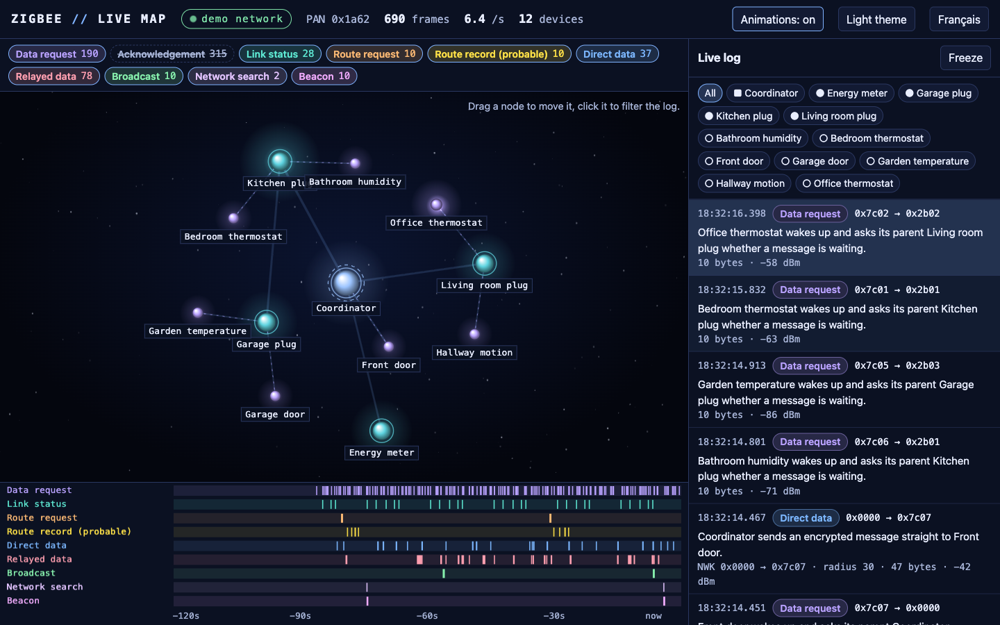

# zigbee-live-map

Watch your Zigbee network talk, live, in your browser.

A cheap USB sniffer dongle listens to the radio. Every frame becomes an animation on a map of your devices and a plain-language line in a log, so you can see who talks to whom, which router relays what, and how the mesh actually works.



## What you see

- **A living map.** The coordinator, routers and battery devices appear as they are heard, and arrange themselves. Drag nodes around, click one to focus on it.
- **One animation per frame.** A dot runs along the link for a message sent to one device, and you watch relays chain hop after hop. A broadcast is a ring that spreads from router to router.
- **A log that explains itself.** Each frame gets a colour-coded category and a sentence: *"Hallway motion wakes up and asks its parent Living room plug whether a message is waiting."*
- **The rhythm of the protocol.** A two-minute strip per category shows the patterns, such as every router announcing its links every 15 seconds.
- **A device sheet.** Role, parent, children, frames relayed, signal strength at the sniffer, and whether the router's beacons say it accepts children.
- **An optional watch on one device.** Nothing is singled out by default. Click "Watch this device" on a router and it is highlighted, while the header keeps count of its children, what it relays and what it repeats. Handy to check that a router really behaves the way you configured it.
- English and French, dark and light themes, keyboard accessible.

## Try it in one minute, without hardware

From a clone of this repository:

```sh
uv run zigbee-live-map --demo --open
```

This runs a simulated network of twelve devices with realistic traffic. No dongle needed.

## Use it on your network

### Hardware

A **CC2531 USB dongle flashed with the TI packet sniffer firmware** (USB id `0451:16ae`). A CC2531 running coordinator firmware, the one Zigbee2MQTT or ZHA use, will not work: it has to be the sniffer firmware.

You also need libusb:

| System | Command |
|---|---|
| macOS | `brew install libusb` |
| Debian, Ubuntu | `sudo apt install libusb-1.0-0` |

On Linux, give your user access to the dongle with a udev rule, for example in `/etc/udev/rules.d/99-cc2531-sniffer.rules`:

```
SUBSYSTEM=="usb", ATTR{idVendor}=="0451", ATTR{idProduct}=="16ae", MODE="0660", GROUP="plugdev"
```

### Install

```sh
uv tool install .        # or: pipx install .
```

### Find your channel, then watch

```sh
zigbee-live-map --scan           # listens 2 s on each of the 16 channels
zigbee-live-map --channel 15 --open
```

```
channel  frames  best RSSI  PAN ids (frames)
     15      11    -50 dBm  0x1a62 (6)
     20       9    -71 dBm  0x7b21 (5)
```

Your hub also shows the channel in its settings. You can change channel from the page at any time: the map starts over on the new one.

## Device names

Zigbee devices do not know that they are called "Kitchen plug". That name exists only in your hub's database and is never transmitted, so a sniffer cannot discover it. What travels in clear is the short address and the factory IEEE address of each device.

Names therefore come from you, and stay on your machine in `names.json` (ignored by git):

- **Rename in the page**: click a device, type a name, save.
- **Import a list from your hub**: export or copy your device table to a CSV or tab-separated file with a header row, then

  ```sh
  zigbee-live-map --import-names devices.csv
  ```

  It needs an IEEE column and a name column. Model and short-address (`nwk`) columns are used when present.

The format is in [`names.example.json`](names.example.json). The optional `nwk` field lets a device be named from its first frame, before its IEEE address has been heard.

## Reference

```
zigbee-live-map [--channel N | --demo | --replay PCAP] [options]

  --channel N          Zigbee channel, 11 to 26
  --demo               simulated network, no hardware needed
  --replay PCAP        replay a capture (pcap, linktype 802.15.4) with its timing
  --speed X            speed factor for --replay and --demo
  --pcap OUT           also record the live capture, readable by Wireshark
  --scan [SECONDS]     listen on each channel, print what is there, exit
  --import-names FILE  merge a CSV/TSV device list into the names file, exit
  --names FILE         names file (default ./names.json)
  --focus IEEE         start with this device watched (same as the Watch button)
  --port N             local port (default 8765)
  --open               open the page in your browser
```

## How it works

```
CC2531 sniffer ──USB──▶ sniffer.py ──frames──▶ frames.py ──events──▶ server.py ──WebSocket──▶ page
  (receive only)        (libusb)             (header decoding)       (127.0.0.1)          (canvas)
```

Two layers of a Zigbee frame are readable by anyone in radio range, and this is all the tool uses:

- the **MAC header** (IEEE 802.15.4): which device transmits this radio hop, and to whom;
- the **NWK header** (Zigbee): who wrote the message, who it is finally for, how many hops are left, and the IEEE address of the device that secured this hop.

Comparing the two is what reveals routing: when the radio sender is not the author, a router is relaying. Parent-child links come from data requests, since a sleeping device only ever polls its parent.

The header decoder has no dependency beyond the standard library. Its output was compared field by field with Wireshark's dissector (`tshark`) on a real capture and on the demo traffic.

## Scope and privacy

- **Receive only.** The sniffer firmware cannot transmit, and this tool never sends anything on the radio.
- **Headers only.** Everything after the NWK header is encrypted with your network key. The tool does not ask for the key and does not decrypt. It shows who talks to whom, when and how much, never what is said. Network commands are recognised by their shape and labelled "probable" when that is a deduction.
- **Local only.** The server listens on `127.0.0.1` and refuses WebSocket connections coming from another website. Nothing leaves your machine.
- **Your data stays out of the repository.** `names.json` and `*.pcap` are in `.gitignore`. A capture contains your devices' addresses: think before sharing one.
- Traffic of a neighbouring network on the same channel is recognised by its PAN id and kept off the map. Use this on networks you own or are allowed to monitor.

## Limits

- The dongle only hears what reaches it. A far-away device may be missing, and a missing frame is not proof that it was not sent.
- Signal strength (dBm) is what the sniffer received, not the link quality between two devices.
- One sniffer model is supported for now. `sniffer.py` is small and isolated: other 802.15.4 sniffers can be added there.
- Zigbee PRO only. Green Power frames and other 802.15.4 protocols show up as "not decoded".

## Development

```sh
uv run pytest
uv run zigbee-live-map --demo --speed 3
```

The page is a single file, `src/zigbee_live_map/static/index.html`, without a build step. The demo network in `demo.py` produces well-formed frames, so the whole pipeline can be exercised without a dongle.

## License

MIT
