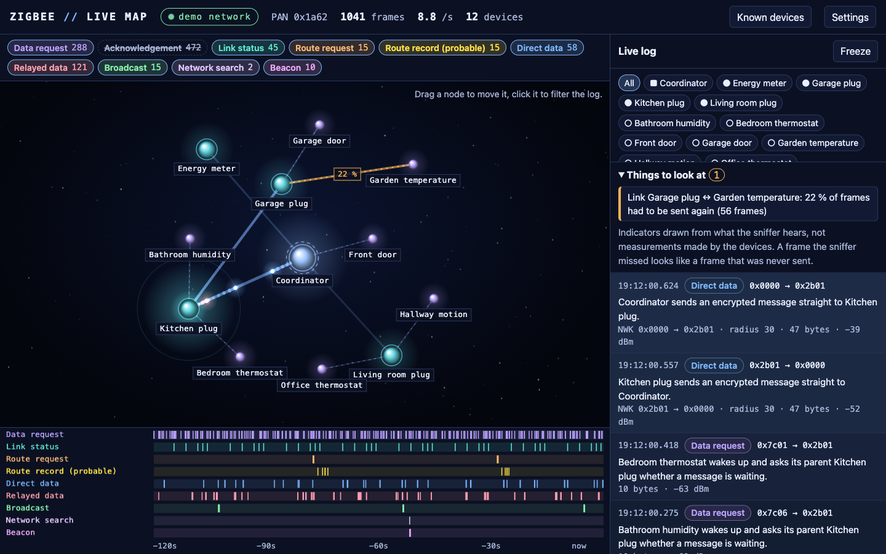

# Zigbee Live Map

Watch your Zigbee network talk, live: a map of your devices, one animation per frame, a log that explains each frame in plain words, and a panel of things worth a look (weak links, slow routers, messages nobody collects). It only listens: it never transmits on the radio.

**You need a second USB dongle**: a CC2531 flashed with the TI packet sniffer firmware (USB id `0451:16ae`). The dongle your Zigbee integration uses cannot be shared with this app.

**No dongle yet?** Install the app and turn on its *Demo network* option: it shows a simulated network.

The options, where your data is kept and what has not been tested are on the **Documentation** tab.
